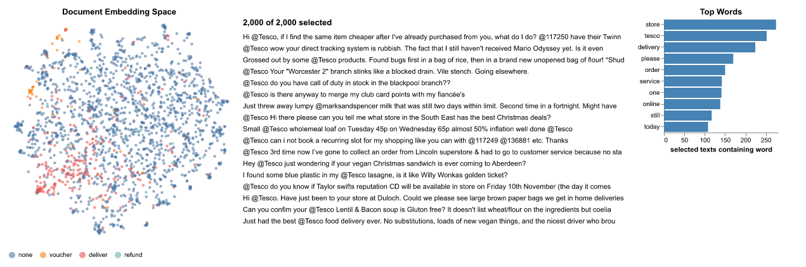
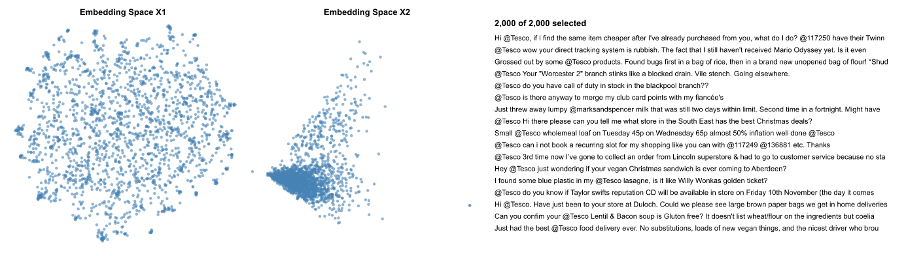

# embedscope

> Look inside your text embeddings.

embedscope makes interactive charts that help you explore text data. Plot your texts
in two dimensions, drag a rectangle over a cluster, and see what is in it: how many
texts, what they say, and which words they share. Then pull the selection straight
back into Python to label it, export it or dig further.

It's handy at the start of a classification project, when you are still figuring out
what good labels for your dataset might be.



You can also compare two embedding techniques side by side.



## Install

```text
python -m pip install embedscope
```

To get selections back into Python (see below), install the widget extra:

```text
python -m pip install "embedscope[widget]"
```

Requires Python 3.10 or newer.

## Coming from cluestar?

embedscope is a maintained fork of [cluestar](https://github.com/koaning/cluestar) by
Vincent D. Warmerdam. The functions and arguments are the same, so switching is a
one-line change:

```python
# from cluestar import plot_text, plot_text_comparison
from embedscope import plot_text, plot_text_comparison
```

What's new compared to cluestar 0.2.1:

- Works on a fresh install with current Python, Altair, pandas and numpy.
- A live "N of M selected" count and a "top words" panel.
- Cluster ids and labels become categories, and you can click the legend to filter.
- `widget=True` lets you get the selected rows back as a DataFrame.

You can toy around with the demo notebook found [here](https://github.com/MLResearch42/embedscope/blob/main/notebooks/overview.ipynb).

## Usage

The first step is to encode textdata in two dimensions, like below.

```python
from sklearn.pipeline import make_pipeline
from sklearn.decomposition import TruncatedSVD
from sklearn.feature_extraction.text import TfidfVectorizer

pipe = make_pipeline(TfidfVectorizer(), TruncatedSVD(n_components=2))

X = pipe.fit_transform(texts)
```

From here you can make an interactive chart via;

```python
from embedscope import plot_text

plot_text(X, texts)
```

The best results are likely found when you use
[umap](https://umap-learn.readthedocs.io/en/latest/)
together with something like
[universal sentence encoder](https://koaning.github.io/whatlies/api/language/universal_sentence/).

Drag a rectangle over the scatter plot to select points. The panels on the right
update as you drag:

- **"293 of 2,000 selected"**: how many points are in your selection.
- **text**: the first few texts in the selection (hover a point to see its full text).
- **top words**: the words that appear in the most selected texts, ignoring common filler
  words, URLs and @mentions. Use `top_words=0` to hide this panel.

Double-click the scatter plot to clear the selection.

### Coloring points

You might also improve the understandability by highlighting points
that have a certain word in it.

```python
plot_text(X, texts, color_words=["plastic", "voucher", "deliver"])
```

You can also color by an array. Floats, like predicted probabilities, get a color scale.

```python
# First, get an array of probabilities from some model
p_vals = some_model.predict_proba(texts)[:, 0]
plot_text(X, texts, color_array=p_vals)
```

Anything else, like cluster ids, labels you already have or booleans, is treated as
categories. **Click a category in the legend** to show only that group; the count, text
and top words panels then only describe that group.

```python
from sklearn.cluster import KMeans

clusters = KMeans(n_clusters=5).fit_predict(X)
plot_text(X, texts, color_array=clusters)
```

### Getting your selection back into Python

Found an interesting cluster? Use `widget=True` and you can pull the selected rows
straight into your notebook, for example to label them or to export them.
This needs one extra package:

```text
python -m pip install "embedscope[widget]"
```

```python
widget = plot_text(X, texts, color_array=clusters, widget=True)
widget  # display it, then drag a rectangle and/or click the legend
```

```python
selected = widget.selected()  # a DataFrame with the text, coordinates and color
selected.index                # positions in `texts`, so df.iloc[selected.index] gets your original rows
```

`widget.selected()` always reflects the current selection, so you can select, run the
cell, select something else and run it again.

### Comparing two embeddings

You can also compare two embeddings interactively. Selecting points in one
chart highlights the same texts in the other.

```python
from embedscope import plot_text_comparison

plot_text_comparison(X1, X2, texts)
```

`plot_text_comparison` takes the same `color_array`, `color_words`, `top_words` and
`widget` arguments as `plot_text`.

## Credits

embedscope started as a fork of [cluestar](https://github.com/koaning/cluestar),
created by Vincent D. Warmerdam and released under the MIT license. Thanks, Vincent!
